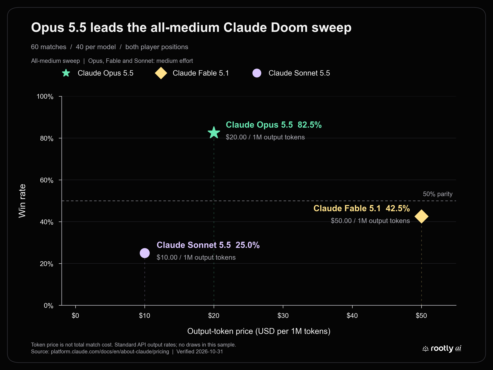
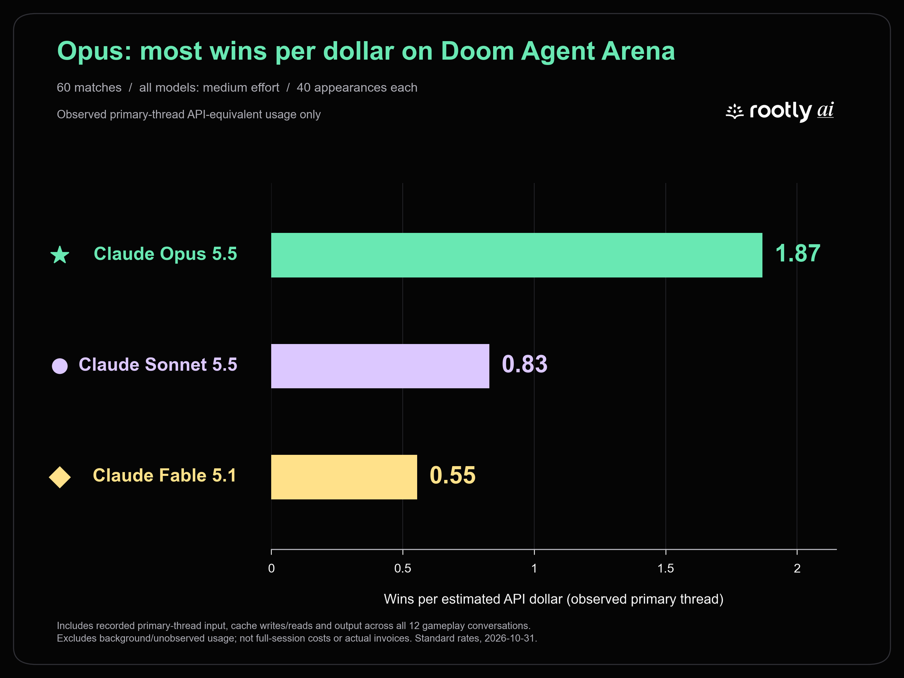

# Claude Doom sweep

**All three models used medium effort**, verified from actual API metadata across twelve conversations. The active comparison contains **60 completed matches**, six ten-round series, 40 appearances per model, and no draws.

| Rank | Model | Win rate | Wins–Losses | Decision speed | Accuracy | Damage diff | Win rate / cost |
| --- | --- | ---: | ---: | ---: | ---: | ---: | ---: |
| 1 | Claude Opus 5.5 | **82.5%** | 33–7 | 5.81s | **86.2%** | **+70.62** | **1.00×** |
| 2 | Claude Fable 5.1 | 42.5% | 17–23 | 11.83s | 52.4% | -23.62 | 0.30× |
| 3 | Claude Sonnet 5.5 | 25.0% | 10–30 | **4.37s ⚡** | 51.4% | -47.00 | 0.44× |

Bold marks the category leader; ⚡ marks the fastest decisions. All models used medium effort.

- **Win rate** = wins ÷ matches played.
- **Decision speed** = mean interval from observation completion to a plan submission; lower is faster. It includes host/orchestration time, retries, and rejected attempts, not only model inference.
- **Accuracy** = total shots hit ÷ total shots fired.
- **Damage diff** = average damage dealt minus opponent damage dealt per match.
- **Win rate / cost** = wins per estimated API dollar, normalized so the best model = 1.00×. The denominator uses observed primary-thread usage across winning and losing matches at Standard API rates.

**Cost scope:** these are API-equivalent estimates from recorded primary-model responses, including input, cache reads/writes, and output. They are not complete full-session costs or actual billed charges: one request lacks response usage, and background usage is incomplete. They are not directly comparable with a leaderboard using full-session costs.

Opus delivered the most wins per observed API-equivalent dollar: **1.87**, compared with Sonnet's **0.83** and Fable's **0.55**. Opus won the most matches; Sonnet made the fastest decisions.

The token-price chart uses published output-token prices; the wins-per-dollar chart and leaderboard's cost-efficiency column use observed primary-thread usage costs. With no draws, draw-adjusted scores equal win rates. Read the **[full analysis](analysis/README.md)** for all five figures, player-position results, timing, route validity, audited usage, and coverage limits.

Models tested: `claude-opus-5-5`, `claude-fable-5-1`, `claude-sonnet-5-5`.

[Metrics](analysis/metrics.json) · [Cost audit](analysis/cost_audit.json) · [Pricing](analysis/pricing.json) · [Reproduction](analysis/README.md#reproduce-and-inspect)

[PNG](analysis/figures/claude-wins-per-dollar.png) · [SVG](analysis/figures/claude-wins-per-dollar.svg)
