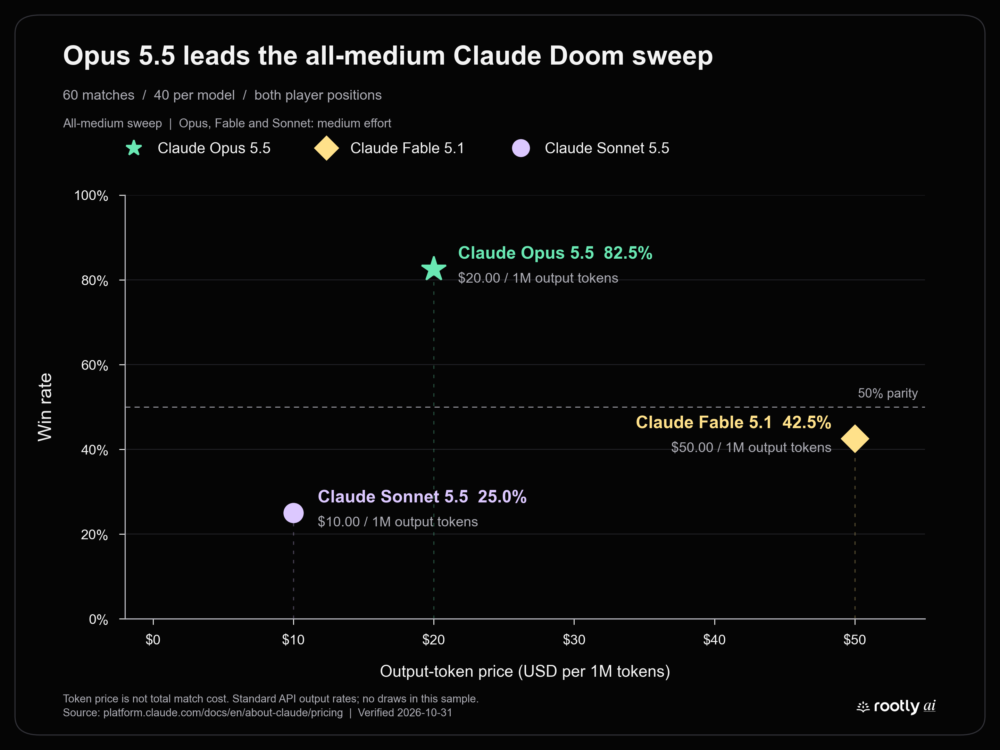
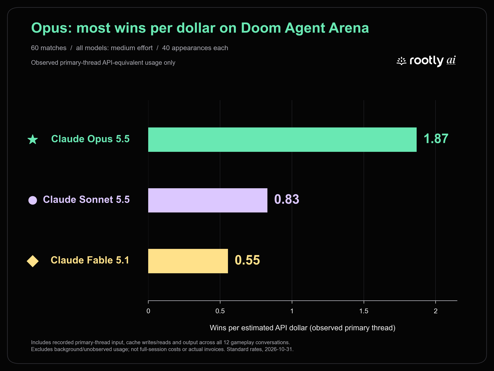
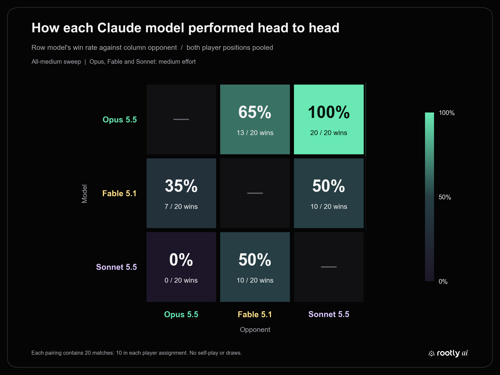
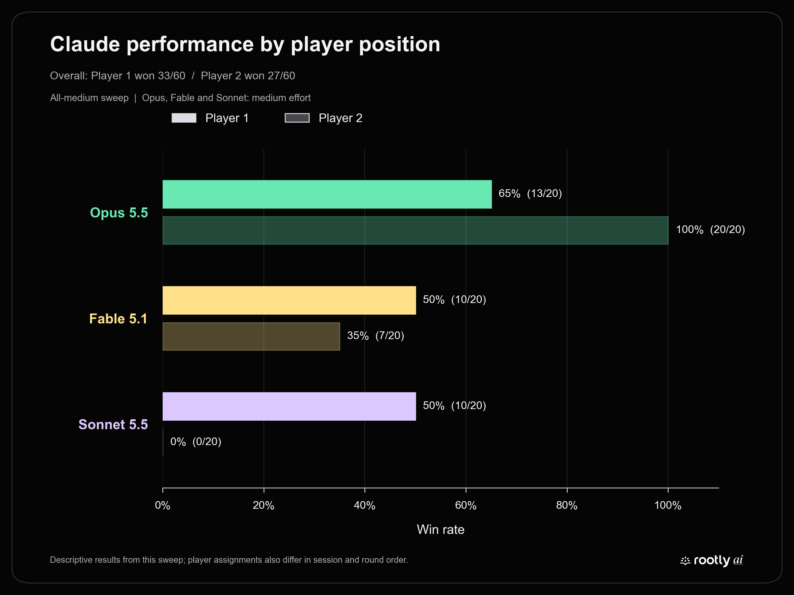
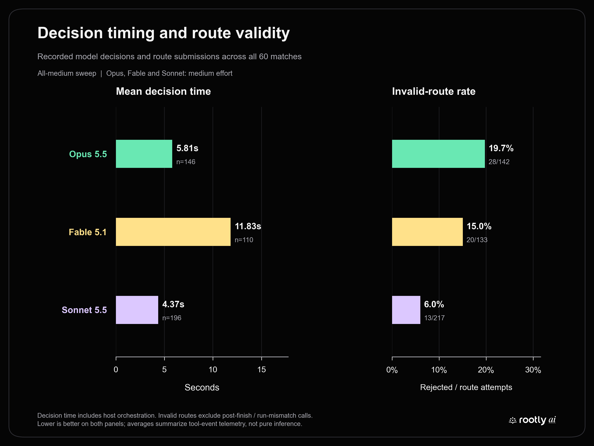

# Claude Opus 5.5 in Doom: 33 wins in 40 matches

**Completed all-medium comparison:** Opus 5.5, Fable 5.1, and Sonnet 5.5 all ran at **medium effort**, verified from actual API metadata for all twelve participant conversations. This is the active 60-match report. Earlier high-effort Fable runs are excluded; their raw archives and the mixed-effort report were removed during cleanup.

Opus finished **33–7 (82.5%)**, Fable **17–23 (42.5%)**, and Sonnet **10–30 (25.0%)**. Each model appeared 40 times: 20 against each opponent and 20 in each player position. All 60 matches ended by elimination; there were no draws.



[PNG](figures/claude-output-token-price-vs-win-rate.png) · [SVG](figures/claude-output-token-price-vs-win-rate.svg)

The x-axis is published **output-token list price**, not total match cost. Equal effort labels improve comparability but do not establish equal inference compute across different models. Results describe the complete agent systems used here.

## Most interesting results

- **Opus led both overall pairings:** 20–0 against Sonnet and 13–7 against Fable.
- **The Opus–Fable result reversed with series orientation:** Opus lost 3–7 as Player 1, then won 10–0 as Player 2. A model-only explanation is insufficient.
- **Fable and Sonnet split their matchup 10–10, with Player 1 winning every round:** Sonnet won 10–0 as Player 1, and Fable won 10–0 after positions switched. Side, chronology, and conversation history are intertwined; the scores do not identify which caused the result.
- **Sonnet remained fastest and made the fewest invalid routes:** 4.37-second mean decision intervals and 6.0% route rejection, alongside a 25.0% win rate. Speed and valid geometry alone did not guarantee wins.
- **Opus also had the best pooled shooting results:** 86.2% accuracy and +70.62 damage per match. These outcomes do not prove a particular tactic caused its advantage.

## Leaderboard

| Rank | Model | Win rate | Wins–Losses | Decision speed | Accuracy | Damage diff | Win rate / cost |
| --- | --- | ---: | ---: | ---: | ---: | ---: | ---: |
| 1 | Claude Opus 5.5 | **82.5%** | 33–7 | 5.81s | **86.2%** | **+70.62** | **1.00×** |
| 2 | Claude Fable 5.1 | 42.5% | 17–23 | 11.83s | 52.4% | -23.62 | 0.30× |
| 3 | Claude Sonnet 5.5 | 25.0% | 10–30 | **4.37s ⚡** | 51.4% | -47.00 | 0.44× |

Bold marks the category leader; ⚡ marks the fastest decisions. All models used medium effort.

- **Win rate** = wins ÷ matches played.
- **Decision speed** = mean interval from observation completion to a plan submission; lower is faster. It includes host/orchestration time, retries, and rejected attempts, not only model inference.
- **Accuracy** = total shots hit ÷ total shots fired.
- **Damage diff** = average damage dealt minus opponent damage dealt per match.
- **Win rate / cost** = wins per estimated API dollar, normalized so the best model = 1.00×. The denominator uses observed primary-thread usage across winning and losing matches at Standard API rates.

**Cost scope:** these are API-equivalent estimates from recorded primary-model responses, including input, cache reads/writes, and output. They are not complete full-session costs or actual billed charges: one request lacks response usage, and background usage is incomplete. They are not directly comparable with a leaderboard using full-session costs.

Opus delivered the most wins per observed API-equivalent dollar: **1.87**, compared with Sonnet's **0.83** and Fable's **0.55**. Opus won the most matches; Sonnet made the fastest decisions.



[PNG](figures/claude-wins-per-dollar.png) · [SVG](figures/claude-wins-per-dollar.svg)

Models tested: `claude-opus-5-5`, `claude-fable-5-1`, `claude-sonnet-5-5`.

All entries use medium effort. Shot accuracy pools hits and shots: Claude Opus 5.5 **175/203**; Claude Fable 5.1 **153/292**; Claude Sonnet 5.5 **180/350**. Damage differential is total damage dealt minus opponents' damage dealt, divided by appearances. These are not averages of round-level percentages.

## Head-to-head and player positions

| Focal model | Opponent | Focal as P1 | Focal as P2 | Combined wins–losses | Win rate |
| --- | --- | --- | --- | --- | --- |
| Claude Opus 5.5 | Claude Sonnet 5.5 | 10–0 | 10–0 | 20–0 | 100% |
| Claude Opus 5.5 | Claude Fable 5.1 | 3–7 | 10–0 | 13–7 | 65% |
| Claude Fable 5.1 | Claude Sonnet 5.5 | 10–0 | 0–10 | 10–10 | 50% |



[PNG](figures/claude-pairwise-win-rate.png) · [SVG](figures/claude-pairwise-win-rate.svg)

| Model | Player 1 record | Player 2 record |
| --- | --- | --- |
| Claude Opus 5.5 | 13–7 (65%) | 20–0 (100%) |
| Claude Fable 5.1 | 10–10 (50%) | 7–13 (35%) |
| Claude Sonnet 5.5 | 10–10 (50%) | 0–20 (0%) |



[PNG](figures/claude-player-side-performance.png) · [SVG](figures/claude-player-side-performance.svg)

Positions were swapped after each ten-round series. That balances appearances but does not randomize individual rounds or erase history. Extreme series reversals and small samples are reasons to report both orientations, rather than treating pooled rates as precise estimates of general model ability.

## Cohort selection and completed series

The primary cohort uses the **first completed medium-effort series for each ordered pairing**. It retains the original 20 Opus–Sonnet rounds, already at medium, and adds 40 medium-effort Fable rerun rounds. Selection follows completion chronology; it is **not claimed to have been preregistered**.

An additional Sonnet-as-Player-1 versus Fable series, `session_fcc7bb2f60a8`, ended 5–5 and is preserved but excluded from the primary cohort. Including both same-orientation series would change weighting. That additional result also means the primary 10–0 outcome is not a repeatability guarantee. The four older Fable-high series and incomplete/restarted runs are excluded.

| # | Archive | Player 1 | Player 2 | P1–P2 | P1 observed cost | P2 observed cost |
| --- | --- | --- | --- | --- | --- | --- |
| 1 | [session_8fdec3c440b4](../med_reruns/opus%20v%20sonnet/med_opus%20v%20sonnet/session_8fdec3c440b4/) | Claude Opus 5.5 | Claude Sonnet 5.5 | 10–0 | $3.7591 | $2.1230 |
| 2 | [session_5188b2ed236f](../med_reruns/opus%20v%20sonnet/med_sonnet%20v%20opus/session_5188b2ed236f/) | Claude Sonnet 5.5 | Claude Opus 5.5 | 0–10 | $2.5895 | $5.0716 |
| 3 | [session_572d2d193f0a](../med_reruns/opus%20v%20fable/med_opus%20v%20fable/session_572d2d193f0a/) | Claude Opus 5.5 | Claude Fable 5.1 | 3–7 | $3.4990 | $7.1488 |
| 4 | [session_acd0e0242118](../med_reruns/opus%20v%20fable/med_fable%20v%20opus/session_acd0e0242118/) | Claude Fable 5.1 | Claude Opus 5.5 | 0–10 | $6.0507 | $5.3327 |
| 5 | [session_60e8ac8a1dda](../med_reruns/sonnet%20v%20fable/med_sonnet%20v%20fable/session_60e8ac8a1dda/) | Claude Sonnet 5.5 | Claude Fable 5.1 | 10–0 | $3.9503 | $8.0851 |
| 6 | [session_da8fd5b5d730](../med_reruns/sonnet%20v%20fable/med_fable%20v%20sonnet/session_da8fd5b5d730/) | Claude Fable 5.1 | Claude Sonnet 5.5 | 10–0 | $9.3618 | $3.3965 |

All six primary series are complete, with ten unique finished rounds each. The Opus–Sonnet folders under `med_reruns` contain retained originals, not newly played duplicates. Costs above use the primary-thread scope below, not complete bills.

## Decision timing and route validation

| Model | Intervals | Mean | Median | 95th percentile |
| --- | --- | --- | --- | --- |
| Claude Opus 5.5 | 146 | 5.808 s | 5.134 s | 9.842 s |
| Claude Fable 5.1 | 110 | 11.830 s | 9.123 s | 33.663 s |
| Claude Sonnet 5.5 | 196 | 4.365 s | 3.942 s | 7.235 s |

These **452 intervals** run from observation completion to the start of a `set_participant_plan` call. They include orchestration, opening preparation, retries, rejected routes, and post-finish attempts: **not pure inference latency or time to a valid plan**. Another 88 calls have no qualifying interval; no duration is invented. Means pool individual intervals; the 95th percentile uses linear interpolation.

Fable's three largest intervals are **50.670 s, 47.758 s, 43.423 s**, all accepted opening plans before its first accepted-plan completion in their respective rounds. They remain in the data. Across all models, 14 additional intervals reuse an earlier observation, so retry timings are dependent. The historical high-effort Fable outliers are outside this cohort.



[PNG](figures/claude-decision-time-and-route-validity.png) · [SVG](figures/claude-decision-time-and-route-validity.svg)

**Route rejection rate = invalid routes / (accepted plans + invalid routes).** Every recorded attempt counts, including retries. Validation may return `accepted:false` with `is_error:false`; the analyzer counts that as rejection. Unknown error messages stop analysis for manual review.

| Model | Accepted | Diagonal | Blocked | >8 waypoints | Stationary | Invalid / validated | Rejection rate |
| --- | --- | --- | --- | --- | --- | --- | --- |
| Claude Opus 5.5 | 114 | 26 | 1 | 0 | 1 | 28/142 | 19.7% |
| Claude Fable 5.1 | 113 | 20 | 0 | 0 | 0 | 20/133 | 15.0% |
| Claude Sonnet 5.5 | 204 | 12 | 1 | 0 | 0 | 13/217 | 6.0% |

Diagonal segments change row and column together; blocked routes enter or cross walls. Stationary rejection means the required explicit hold objective/policy was missing. Operational failures are excluded from both sides of the route-rate denominator:

| Model | Post-finish | Run mismatch | All plan calls | All rejected / all calls |
| --- | --- | --- | --- | --- |
| Claude Opus 5.5 | 18 | 0 | 160 | 46/160 (28.7%) |
| Claude Fable 5.1 | 9 | 0 | 142 | 29/142 (20.4%) |
| Claude Sonnet 5.5 | 21 | 0 | 238 | 34/238 (14.3%) |

The 540 plan calls comprise **431 accepted, 61 route rejections, and 48 operational failures**. Another 8 post-finish failures came from `stop_participant_intent`, outside the plan tables. Combined error rates and route-rejection rates measure different things.

## Primary-thread cost and token accounting

**These are API-equivalent estimates for observed primary-model messages, not all-in tournament costs.** All twelve logs match the selected session, ten run IDs, side, alias, and actual model ID. Every recorded request, response effort field, and per-turn effort field reports medium. Included work covers tool discovery, startup, gameplay, between-round waits, retries, and final summaries; unrelated conversations are excluded.

| Model | Observed primary-thread estimate | Estimate / appearance | Cost-state snapshots |
| --- | --- | --- | --- |
| Claude Opus 5.5 | $17.66247100 | $0.4416 | 4/4 |
| Claude Fable 5.1 | $30.64643825 | $0.7662 | 3/4 |
| Claude Sonnet 5.5 | $12.05937420 | $0.3015 | 3/4 |

Observed primary-thread usage totals **$60.36828345**. The audit deduplicates **1,194 API responses**, removing **1,369 repeated assistant content rows**; each response counts once. Per-appearance costs divide four conversation totals by 40, rather than assigning tokens to individual rounds or plans.

| Usage category | Opus 5.5 | Fable 5.1 | Sonnet 5.5 |
| --- | --- | --- | --- |
| Uncached input | 766 | 11,720 | 894 |
| Cache-read input | 47,835,295 | 43,363,313 | 66,885,702 |
| One-hour cache-write input | 716,471 | 635,723 | 929,319 |
| Output | 118,029 | 139,479 | 165,174 |
| Thinking, included in output | 22,278 | 55,816 | 45,894 |
| Unique API responses | 379 | 370 | 445 |

Uncached input, cache reads, and cache writes are distinct input categories. All writes used a one-hour TTL; five-minute writes were zero. Thinking tokens are part of output and are not charged again. See the official [prompt-caching documentation](https://platform.claude.com/docs/en/build-with-claude/prompt-caching) and [thinking-cost documentation](https://platform.claude.com/docs/en/build-with-claude/thinking-steering-and-cost).

### Pricing and coverage

| Model | Uncached input / M | Cache read / M | 1-hour write / M | Output / M |
| --- | --- | --- | --- | --- |
| Claude Opus 5.5 | $4 | $0.2 | $8 | $20 |
| Claude Fable 5.1 | $10 | $0.25 | $20 | $50 |
| Claude Sonnet 5.5 | $2 | $0.1 | $4 | $10 |

USD per million tokens, checked **October 31, 2026**, against [official Claude API pricing](https://platform.claude.com/docs/en/about-claude/pricing), with Fable corroborated by its [model page](https://platform.claude.com/docs/en/models/fable-5-1/whats-new-fable-5-1). Requests used standard speed and global inference. [pricing.json](pricing.json) preserves the rates.

```text
Estimated USD = (uncached input × input rate
               + cache-read input × read rate
               + one-hour cache writes × write rate
               + output × output rate) / 1,000,000
```

There is **1 request without corresponding response usage**; no missing tokens or charge are invented. Cumulative snapshots exist for **10/12 conversations**, with unequal coverage. Their partial sum is **$47.73119415**, and 3 include additional primary-model usage beyond the transcript. Auxiliary background usage appears too. These whole-conversation snapshots are not certified bounded tournament costs and must not replace or be added to the observed-message estimate.

No later `/model` command was found in the selected conversations, but that does not make incomplete/background-inclusive snapshots a tournament bill. The leaderboard reports normalized wins per observed primary-thread dollar; a full-session cost-efficiency ranking remains unavailable. Subscription allocation, credits, tax, negotiated rates, and unseen work are outside the estimates. [cost_audit.json](cost_audit.json) preserves coverage and source hashes without publishing private conversations.

## Methodology and limitations

- **Control split:** Claude Code agents observe state and submit high-level routes through MCP. The shared Doom controller handles movement, aiming, firing, and recovery. Results apply to that agent-system setup.
- **Settings:** All 59 available configs agree: E1M8 `duel_e1m8_blind_spawn`; seed 42; 180-second timeout; hierarchical routes; 25,000 ms configured intent duration; 750 ms decision cadence; fog and weapon pickups enabled; randomized spawns disabled. The first retained Opus–Sonnet round lacks its config and both prompts, preventing an independent check of its full setup from those artifacts.
- **Prompts:** The 118 saved prompts have different raw hashes because of tokens and headers. From `BENCHMARK ISOLATION` onward, replacing controller-token values yields one identical game-instruction body per player across available prompts. This excludes preceding identity/alias/round headers and unsaved client context.
- **Time and history:** Telemetry spans October 31, 2026, **01:39–05:44 UTC**: Toronto October 30 at **21:39** through October 31 at **01:44**. These are initialization/snapshot boundaries, not exact combat boundaries. Continuing conversations retain earlier-round history; rounds are not independent randomized trials.
- **Effort:** All participants used medium, verified by archived evidence and private logs. Equal labels do not ensure equal compute. Changes from historical high-effort results also involve new sessions and chronology, so this is not an isolated causal test of effort.
- **Telemetry:** All 1,579 call totals reconcile. However, 2 rounds have one extra accepted-call record: **431 accepted plans versus 429 intent lifecycle records** overall. Error rates use calls; acceptance does not prove a distinct executed lifecycle. Two stale-run `get_match_result` records do not enter plan/timing metrics.
- **Evidence limits:** Arena token-usage fields are empty; costs come from audited logs. Zero `rationales_logged` does not prove no reasoning occurred. Text-derived pickup counts are omitted because the parser can match plan words such as “shotgun”; no tactical causal explanation is inferred from them.

## Reproduce and inspect

From the repository root:

```powershell
python claude_sweep/analysis/analyze_claude.py
# Optional: requires private Claude Code gameplay logs.
python claude_sweep/analysis/cost_audit.py --log-root "PATH_TO_PRIVATE_PROJECT_LOGS"
python claude_sweep/analysis/generate_figures.py
python claude_sweep/analysis/build_report.py
```

The core analyzer uses Python's standard library; figures require Matplotlib, NumPy, and Pillow. Without private logs, retain the cost audit and regenerate public metrics, figures, and Markdown. [metrics.json](metrics.json) contains round aggregates, timing samples, exclusions, six effort-verification sidecars, and hashes for **303 existing inputs**, with **3 missing artifacts** recorded. Both analyzers pin selected sessions. Duplicate archives/run IDs, wrong models or effort, and unknown plan failures stop analysis.

Artifacts: [analyzer](analyze_claude.py), [metrics](metrics.json), [cost script](cost_audit.py), [cost data](cost_audit.json), [pricing](pricing.json), [figure generator](generate_figures.py), [report generator](build_report.py). PNG and SVG downloads accompany every figure. [Sweep index](../README.md).
